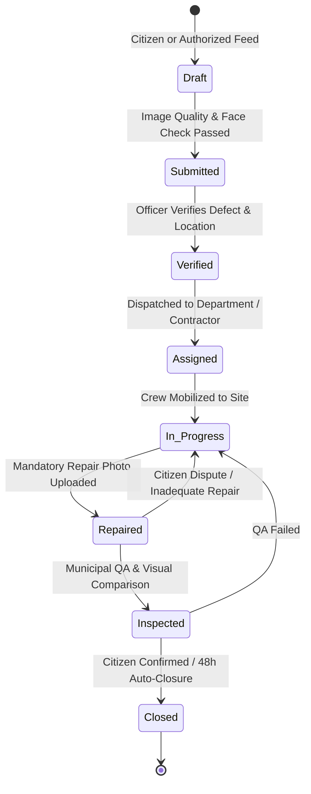
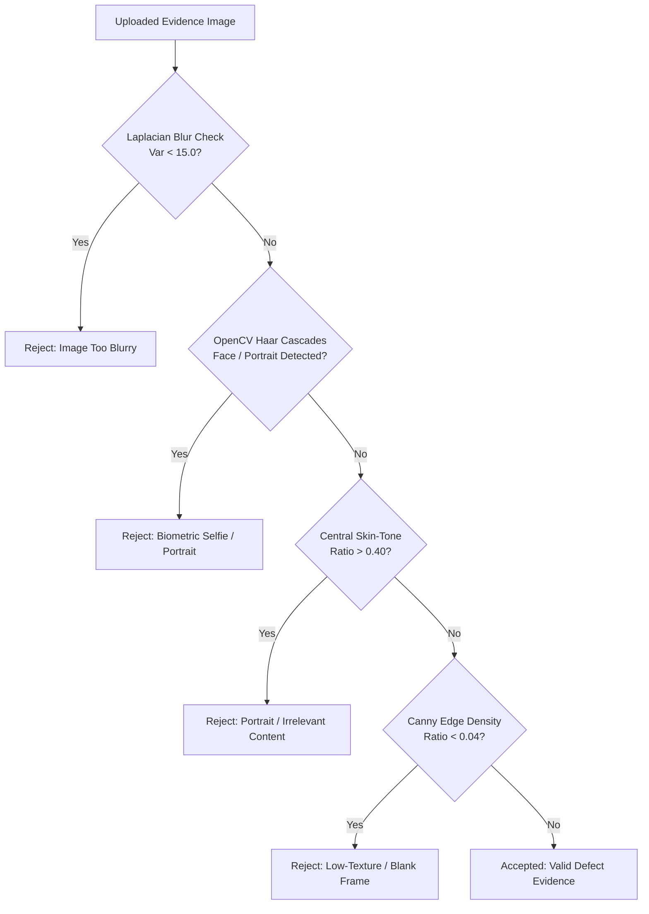
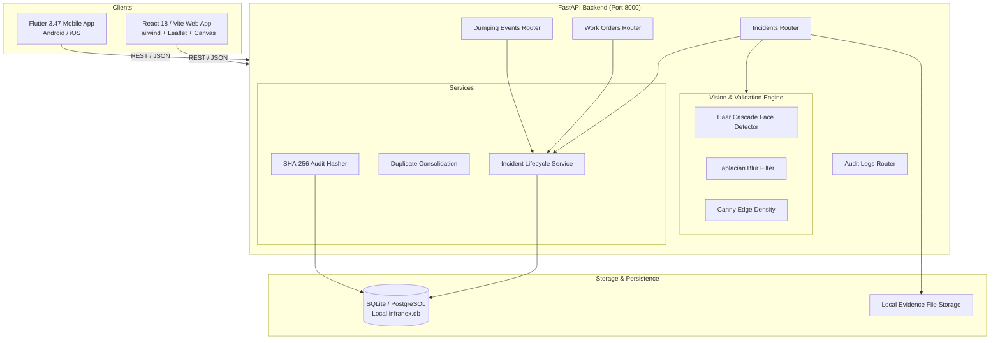

# INFRANEX AI (ಜನಸ್ಪಂದನ)
### Intelligent Civic Infrastructure Monitoring & Incident Lifecycle Management Platform

[](https://infranexai.netlify.app/)
[](https://vitejs.dev/)
[-emerald)](https://fastapi.tiangolo.com/)
[](https://flutter.dev/)
[](https://python.org/)
[](#license-status)

---

## 1. Project Overview

> [!TIP]
> **🌐 Live Production Demonstration**: The web platform is live and deployed at **[https://infranexai.netlify.app/](https://infranexai.netlify.app/)**.
> You can test citizen incident reporting, the AI selfie/blur rejection gate, interactive 2.5D smart-city canvas, 8-stage case lifecycle tracker, contractor repair verification, and instant Demo Mode role switching directly in your browser.

**INFRANEX AI** (ಜನಸ್ಪಂದನ — *Jana Spandana*, Citizen Responsiveness) is an accountable civic infrastructure intelligence and lifecycle management platform focused on real-world urban challenges in Bengaluru. 

The platform bridges the gap between citizens, field engineers, municipal contractors, and urban administrators by unifying citizen reporting, AI-assisted image validation, authorized monitoring streams, automated triage, sequential work orders, and photographic before-and-after repair verification into a tamper-evident workflow.

---

## 2. Civic Infrastructure Problem Addressed

Rapid urban expansion across Bengaluru has introduced recurring infrastructure breakdowns:
- **Potholes & Road Deterioration**: Potholes and asphalt erosion go unaddressed or receive superficial temporary patches that quickly fail.
- **Illegal Solid Waste Dumping**: Chronic dumping blackspots persist across stormwater drains, vacant plots, and roadside berms despite periodic clearing.
- **Lack of Repair Accountability**: Municipal work orders are often marked "Resolved" administratively without verifiable proof of physical restoration or field inspection.
- **Citizen Frustration & Low Trust**: Citizens file complaints with no transparency regarding departmental triage, contractor assignment, or verified closure, leading to duplicate reports and civic apathy.

---

## 3. Project Objectives

1. **Verify Evidence Quality Early**: Prevent low-relevance uploads, selfies, corrupted images, and out-of-scope files from burdening municipal triage queues.
2. **Enforce Sequential Accountability**: Provide a strict 8-stage state machine from initial detection to verified closure, preventing premature resolution without contractor proof.
3. **Photographic Verification**: Mandate timestamped contractor repair photos with before-and-after visual inspection and citizen feedback confirmation.
4. **Chronic Dumping Interception**: Track recurring waste hotspots through a multi-stage warning escalation framework rooted in municipal by-laws.
5. **Role-Tailored Productivity**: Deliver purpose-built workspaces for Citizens, Field Officers, Contractors, and Urban Administrators.

---

## 4. Main Features

- **AI-Assisted Image Relevance & Selfie Gate**: Multi-stage computer vision scan that verifies image sharpness, checks edge density for defects, and screens out human faces/portraits prior to ticket submission.
- **8-Stage Incident Lifecycle**: Rigid, auditable lifecycle (`Draft` → `Submitted` → `Verified` → `Assigned` → `In Progress` → `Repaired` → `Inspected` → `Closed`).
- **Mandatory Contractor Repair Evidence**: Contractors cannot mark a ticket repaired without uploading geo-referenced, timestamped photographic evidence of physical restoration.
- **Interactive Before-and-After Evidence Viewer**: Side-by-side and interactive slider comparison directly comparing original citizen evidence against contractor completion photos.
- **Citizen Repair Confirmation & Dispute Flow**: Original reporters receive notification upon repair with a 48-hour window to confirm satisfaction or dispute incomplete work.
- **Illegal Dumping Intelligence Hub**: Recurring hotspot tracking with automated 3-stage progressive warnings and legal-standard enforcement notice review under BBMP Solid Waste Management by-laws.
- **Demo Mode Role Switcher**: Interactive macOS-inspired segmented controller allowing seamless demonstration of all 4 stakeholder perspectives without clearing active state.
- **Interactive 2.5D Animated Bengaluru Canvas**: Real-time canvas visualization of Bengaluru corridors with pulsing issue markers and live status telemetry.
- **Multi-Client Architecture**: Unified ecosystem featuring a React/TypeScript web app, a FastAPI REST backend, and a cross-platform Flutter client.

---

## 5. Incident Lifecycle Workflow



---

## 6. Garbage-Dumping Monitoring Concept

Chronic waste dumping requires structured escalation rather than isolated ticketing:

1. **Detection & Hotspot Correlation**: Authorized camera nodes or citizen reports log repeat dumping coordinates.
2. **Progressive Warning Ladder**:
   - **Stage 1 (Advisory Notice)**: Neutral informative warning explaining designated drop-off points and collection timings.
   - **Stage 2 (Compliance Directive)**: Official municipal directive advising that the location is under monitored surveillance.
   - **Stage 3 (Final Notice of Violation)**: Notice specifying impending enforcement and statutory penalty provisions.
   - **Stage 4 (Enforcement Review)**: Escalated to municipal enforcement authority (`pending_authority_review`) for formal challan issuance under BBMP Solid Waste Management By-laws 2020.
3. **Audit Trail**: Every escalation step hashes event details, timestamps, and officer notes to maintain legal defensibility.

---

## 7. AI Image-Validation Approach

INFRANEX AI employs a layered validation pipeline to verify image relevance before accepting civic reports:



### Technical Specification
- **Face & Portrait Detection**: Pre-loaded OpenCV Haar Cascade classifiers (`haarcascade_frontalface_default.xml` and `haarcascade_profileface.xml`).
- **Skin Color Histogram Analysis**: HSV color-space thresholding ($H \in [0, 25], S \in [38, 250], V \in [50, 255]$) in the central focal region.
- **Sharpness Inspection**: Variance of the Laplacian ($\sigma^2 < 15.0$) detects unusable blurry images.
- **Edge Density Verification**: Canny edge detection verifies structural contrast typical of asphalt cracks, road voids, or debris accumulation.

---

## 8. Role-Specific Capabilities

| Role | Primary Functions & Permissions |
| :--- | :------------------------------ |
| **Citizen (ಜನ)** | Report incidents, photo evidence upload, real-time ticket tracking, view contractor repair photo, confirm resolution or dispute incomplete work within 48h. |
| **Field Officer** | Verify incoming reports, confirm GPS coordinates & severity, dispatch work orders to relevant municipal contractors, perform physical QA inspection. |
| **Contractor Hub** | View assigned work orders, accept task, log mobilization, mandatory upload of completed repair photos, submit repair for municipal inspection. |
| **Admin Command** | Macro Bengaluru city analytics, SLA compliance monitoring, contractor performance ratings, dumping hotspot escalation review, audit logs. |

> **Note on Demo Mode**: The top navigation bar includes an interactive **Demo Mode Switcher** that allows evaluators to toggle between all 4 personas instantly in the web frontend without database credential locks.

---

## 9. Repair Evidence & Accountability Workflow

To end the practice of closing work orders without physical verification:
1. **Contractor Action Lock**: The Contractor interface disables the "Submit Resolution" button until a valid repair photo is staged and validated.
2. **Metadata Binding**: The repair image is permanently bound to the original case ID with upload timestamp, contractor ID, and completion notes.
3. **Interactive Comparison Slider**: Field Officers and Citizens can drag an interactive divider between the original damage photo and the repaired site photo.
4. **Reporter Sign-Off**: The citizen who reported the issue is notified immediately upon repair and given 48 hours to confirm or dispute.

---

## 10. Technology Stack

### Frontend Web
- **Core**: React 18, Vite 6, TypeScript 5
- **Styling**: Tailwind CSS, Lucide React icons, Glassmorphism design tokens
- **Visuals**: HTML5 Canvas 2.5D animated smart-city corridor, Leaflet GIS mapping
- **Hosting**: Netlify Production SPA

### Backend API
- **Framework**: FastAPI (Python 3.12+), Uvicorn ASGI
- **Data Layer**: SQLAlchemy 2.0 ORM, Pydantic v2 schemas
- **Database**: SQLite (default local development) / PostgreSQL + PostGIS (production ready)
- **Computer Vision**: OpenCV (`opencv-python-headless`), NumPy

### Mobile & Cross-Platform Client
- **Framework**: Flutter 3.47+ / Dart 3.13+
- **Platforms**: Android, iOS, Web, macOS, Linux, Windows

---

## 11. Project Architecture



---

## 12. Directory Structure

```
INFRANEX-AI/
├── .gitignore                     # Multi-stack gitignore (Python, Node, Flutter, OS)
├── README.md                      # Comprehensive project documentation
├── analysis_options.yaml          # Flutter Dart analyzer rules
├── pubspec.yaml                   # Flutter dependencies & metadata
│
├── backend/                       # FastAPI Python Backend
│   ├── app/
│   │   ├── main.py                # FastAPI application entrypoint & CORS
│   │   ├── core/                  # Security, config, token management
│   │   ├── database/              # SQLAlchemy database engine & session
│   │   ├── models/                # ORM models (Incident, WorkOrder, DumpingEvent, AuditLog)
│   │   ├── schemas/               # Pydantic v2 validation models
│   │   ├── routers/               # API endpoints (incidents, work_orders, dumping, auth)
│   │   ├── services/              # Business logic (ai_vision_service, audit_service)
│   │   └── weights/               # Haar Cascade XML models for facial screening
│   ├── tests/                     # Automated test suite (19 test cases)
│   │   ├── test_api.py            # API routing, RBAC, and boundary tests
│   │   ├── test_image_validation.py# OpenCV face/blur/edge gate tests
│   │   └── test_incident_lifecycle.py # End-to-end 8-stage lifecycle tests
│   ├── requirements.txt           # Python dependencies
│   └── .env.example               # Backend environment variable template
│
├── website/                       # React / Vite Web Frontend
│   ├── src/
│   │   ├── App.tsx                # Main view router & state provider
│   │   ├── context/               # Global AppContext & role state
│   │   ├── components/
│   │   │   ├── layout/            # Navbar, Demo Mode switcher, Canvas city animation
│   │   │   ├── reporting/         # Citizen report wizard & live selfie gate alert
│   │   │   ├── cases/             # Case management & 8-stage progress tracker
│   │   │   ├── verification/      # Contractor repair photo upload & before/after slider
│   │   │   ├── dumping/           # Illegal dumping monitor & 3-stage warning system
│   │   │   └── manual/            # Interactive user manual & workflow guide
│   │   └── services/              # API clients & mock demonstration data
│   ├── package.json               # Node dependencies & scripts
│   ├── vite.config.ts             # Vite configuration
│   └── tailwind.config.js         # Styling design tokens
│
└── lib/                           # Flutter Cross-Platform Client
    ├── main.dart                  # Flutter entrypoint
    └── src/                       # Flutter screens and models
```

---

## 13. Prerequisites

Before setting up INFRANEX AI locally, ensure the following runtimes are installed on your machine:
- **Node.js**: v18.0.0 or higher ([Download Node.js](https://nodejs.org/))
- **Python**: v3.12 or higher ([Download Python](https://www.python.org/))
- **Flutter SDK** *(optional, for mobile app)*: v3.24+ ([Download Flutter](https://docs.flutter.dev/get-started/install))
- **Git**: v2.30+ ([Download Git](https://git-scm.com/))

---

## 14. Local Installation Instructions

### 1. Clone the Repository
```powershell
git clone https://github.com/your-username/infranex-ai.git
cd infranex-ai
```

### 2. Frontend Setup
```powershell
cd website
npm install
cd ..
```

### 3. Backend Setup
```powershell
cd backend
python -m venv .venv
.\.venv\Scripts\Activate.ps1
pip install -r requirements.txt
cd ..
```

---

## 15. Frontend Startup Commands

In PowerShell from the `website/` directory:

```powershell
cd D:\Development\INFRANEX-AI\website
npm run dev
```
The web application will start at `http://localhost:5173/` (or port `3000` / `3001` depending on port availability).

---

## 16. Backend Startup Commands

In PowerShell from the `backend/` directory:

```powershell
cd D:\Development\INFRANEX-AI\backend
.\.venv\Scripts\Activate.ps1
uvicorn app.main:app --host 127.0.0.1 --port 8000 --reload
```
The FastAPI backend documentation will be accessible at:
- Swagger UI: `http://127.0.0.1:8000/docs`
- ReDoc: `http://127.0.0.1:8000/redoc`
- Health check: `http://127.0.0.1:8000/health`

> **Note on Deployed Web App vs Local Backend**: The public web deployment (e.g. on Netlify) operates in standalone demonstration mode with local storage persistence. To connect the frontend directly to your local FastAPI backend, set `VITE_API_BASE_URL=http://127.0.0.1:8000/api/v1` in `website/.env`.

---

## 17. Flutter Setup Instructions

If developing or building the Flutter client:

```powershell
cd D:\Development\INFRANEX-AI
flutter pub get
flutter analyze
flutter run -d chrome
# Or target an Android device/emulator:
# flutter run -d android
```

---

## 18. Environment Configuration

Copy the template configuration in `backend/.env.example` to `backend/.env`:

```env
PROJECT_NAME="INFRANEX AI Backend"
API_V1_STR="/api/v1"
SECRET_KEY="replace-with-a-secure-random-secret-key-in-production"
ACCESS_TOKEN_EXPIRE_MINUTES=1440

# Database Connection (SQLite by default, PostgreSQL + PostGIS supported)
DATABASE_URL="sqlite:///./infranex.db"

# Allowed CORS Origins for Web Frontend
BACKEND_CORS_ORIGINS=["http://localhost:3000","http://localhost:5173","http://127.0.0.1:3000","http://127.0.0.1:5173"]

# Computer Vision Model Path (Optional external model weights)
AI_MODEL_WEIGHTS_PATH=""
```

---

## 19. API & Health-Check Endpoints

| Method | Endpoint | Description |
| :--- | :--- | :--- |
| `GET` | `/health` | Application status, API version, and database connectivity check |
| `POST` | `/api/v1/incidents/validate-evidence` | Pre-validation check scanning image for selfies, blur, and edge density |
| `POST` | `/api/v1/incidents/` | Create a new incident (enforces image validation gate) |
| `GET` | `/api/v1/incidents/` | List filtered incidents with pagination and status filters |
| `GET` | `/api/v1/incidents/{id}` | Retrieve incident details with full audit log and repair assets |
| `POST` | `/api/v1/work-orders/{id}/repair` | Contractor repair photo upload and completion logging |
| `POST` | `/api/v1/work-orders/{id}/confirm` | Citizen sign-off or dispute registration |
| `GET` | `/api/v1/dumping/events` | List chronic waste dumping events and progressive warning levels |
| `POST` | `/api/v1/dumping/events/{id}/escalate` | Escalate dumping notice (Stage 1 Advisory → Stage 4 Penalty Review) |

---

## 20. Testing & Build Instructions

### Backend Automated Tests
The backend includes a comprehensive pytest suite covering API contracts, image validation algorithms, and full lifecycle execution:

```powershell
cd D:\Development\INFRANEX-AI\backend
.\.venv\Scripts\Activate.ps1
pytest -v
```
**Test Result**: 19 passed across `test_api.py`, `test_image_validation.py`, and `test_incident_lifecycle.py`.

### Frontend Production Build
```powershell
cd D:\Development\INFRANEX-AI\website
npm run build
```
**Build Result**: Successful compilation with Vite into `website/dist/`.

### Flutter Static Analysis
```powershell
cd D:\Development\INFRANEX-AI
flutter analyze
```
**Analysis Result**: `No issues found!`.

---

## 21. Current Implementation Status

| Component / Feature | Current Implementation Status | Verification Notes |
| :--- | :---: | :--- |
| **Frontend Web App** | ✅ Fully Implemented | React 18, Vite 6, Tailwind CSS, 2.5D Canvas animation, Leaflet map |
| **8-Stage Lifecycle Engine** | ✅ Fully Implemented | Strict transition validation, sequential locking, tested in `test_incident_lifecycle.py` |
| **Haar Cascade Selfie Gate** | ✅ Fully Implemented | OpenCV face cascade + central skin color + blur + edge density screening |
| **Contractor Repair Evidence** | ✅ Fully Implemented | Mandatory repair photo submission, before/after visual comparison slider |
| **Citizen Confirm / Dispute** | ✅ Fully Implemented | 48-hour feedback window with automatic state update and dispute routing |
| **Dumping Intelligence Hub** | ✅ Fully Implemented | 3-stage warning escalation + Stage 4 legal notice review workflow |
| **Demo Mode Role Switcher** | ✅ Fully Implemented | Instant navbar persona switching across Citizen, Officer, Contractor, Admin |
| **FastAPI REST Backend** | ✅ Fully Implemented | 19 automated tests passing with zero errors |
| **Local SQLite Persistence** | ✅ Fully Implemented | SQLAlchemy models for Incidents, WorkOrders, Dumping, and AuditLogs |
| **Flutter Mobile Client** | 🔄 Scaffold Verified | Passes `flutter analyze` with 0 issues; UI integrated with base schemas |
| **Deep Learning YOLO Defect Model** | ⏳ Planned Roadmap | Framework configured via `AI_MODEL_WEIGHTS_PATH`; rules-based gate active |
| **Live BBMP Municipal API Sync** | ⏳ Mock Demonstration | Legal notices modeled after 2020 by-laws; live government API sync planned |
| **Live CCTV Hardware Streams** | ⏳ Simulated Ingestion | Video nodes use simulated demo streams for edge detection testing |

---

## 22. Demo & Simulation Limitations

To maintain full transparency regarding the system's operational scope:
- **Computer Vision**: The active image-validation gate reliably screens out selfies, human portraits, blurred frames, and low-texture blank photos using OpenCV Haar Cascades and morphological filters. However, fine-grained semantic categorization of road cracks vs asphalt seams uses threshold heuristics until custom YOLOv8 defect weights are mounted.
- **Role Switching**: The Demo Mode switcher in the navbar is designed for demonstration and evaluation convenience. In production, roles are enforced via JWT bearer tokens and RBAC middleware.
- **Municipal Integrations**: Notices generated for illegal dumping reference official BBMP Solid Waste Management by-law language, but are stored locally and do not dispatch live notices to external municipal databases without authorized government API credentials.

---

## 23. Security & Privacy Considerations

- **Exclusion of Biometrics**: Selfies and human portrait images rejected by the validation gate are dropped immediately in memory and are not stored in persistent databases.
- **Environment Secrets**: No production API keys, database credentials, or secret keys are committed to source control. All sensitive keys are loaded via `.env` files.
- **Audit Defensibility**: Incident status transitions, contractor uploads, and officer notes are hashed using SHA-256 with timestamp tracking to prevent retroactive record alteration.
- **Role-Based Access Control**: Sensitive actions (such as dispatching contractors, approving repair quality, or escalating enforcement) require appropriate role claims.

---

## 24. Future Development Roadmap

1. **YOLOv8 Civic Defect Model**: Train and mount custom PyTorch/ONNX models specifically tuned for Bengaluru road pavement distress and garbage volume estimation.
2. **Citizen SMS / WhatsApp Integration**: Support incident status updates and confirmation links via WhatsApp Business API for citizens without web access.
3. **BBMP Sahaya 2.0 Integration**: Connect backend routers to official municipal grievance APIs for automated ticket synchronization.
4. **Offline Mobile PWA / Flutter Sync**: Enable offline incident capture with background synchronization for field crews in low-connectivity areas.

---

## 25. Contributing

Contributions are welcome! Please follow these guidelines:
1. Fork the repository and create your branch from `main`:
   ```bash
   git checkout -b feature/your-feature-name
   ```
2. Ensure all backend tests pass:
   ```bash
   pytest -v
   ```
3. Ensure the frontend builds cleanly:
   ```bash
   npm run build
   ```
4. Commit your changes with clear, descriptive commit messages:
   ```bash
   git commit -m "feat(lifecycle): add contractor repair photo hash verification"
   ```
5. Push to your branch and submit a Pull Request.

---

## 26. License Status

**No open-source license has been specified yet.** All rights are reserved by the project authors pending official licensing determination.

---

## 27. Acknowledgements

- **OpenCV**: Open Source Computer Vision Library for facial Haar Cascade classifiers and image processing algorithms.
- **Bruhat Bengaluru Mahanagara Palike (BBMP)**: For public civic guidelines and Solid Waste Management By-laws 2020 referenced in the enforcement workflow.
- **FastAPI & Vite Communities**: For high-performance backend and frontend tooling frameworks.
